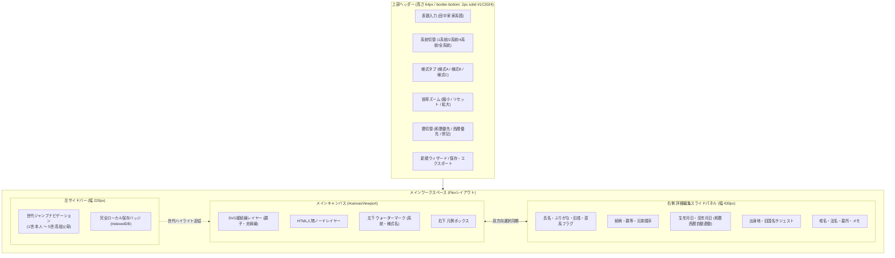
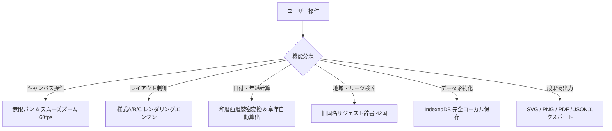

# 和風モダン家系図作成システム - 設計・仕様書

---

## 対象サイトの概要

- **サイト名**：和風モダン家系図作成システム｜公的書類・伝統家譜対応ローカルファーストWebアプリ
- **概要・機能**：
  個人のルーツ探求、相続関係説明図の作成、伝統的な家譜・系図の記録・印刷・保存をブラウザ単体で完結できる、高機能な和風モダン家系図オーサリングWebアプリケーション。
  - **3大表現様式**：
    1. **様式A（先祖トーナメント型）**：5世代31名を階段状に遡るルーツ探求ツリー（直系朱線強調）。
    2. **様式B（法務・直系軸型）**：公的書類・相続関係説明図に準拠した直系親族青帯＆親族呼称表記。
    3. **様式C（伝統家譜型）**：巻物や掛軸を彷彿とさせる和風縦書き・夫婦並列・金襴風表題。
  - **高度な日本固有機能**：
    - 和暦・西暦双方向変換エンジン（慶応〜令和の改元日厳密判定、満年齢・享年・数え年の自動算出）。
    - 旧国名（令制国）サジェスト辞書（明治以前の戸籍・過去帳表記から現代都道府県への逆引き対応）。
  - **ローカルファースト＆プライバシー保護**：
    - IndexedDB / LocalStorage を用いた完全クライアントサイド保存（個人情報のサーバー外部送信ゼロ）。
  - **多彩なエクスポート**：
    - ベクターSVG、印刷用高解像度PNG、A4/A3対応PDF、バックアップ用JSONインポート/エクスポート。
- **使用技術**：
  - HTML5（セマンティックマークアップ、SVG 2.0、アクセシビリティ対応）
  - CSS3（CSSカスタムプロパティ/変数、和紙テクスチャグラデーション、縦書き `writing-mode: vertical-rl`、Flexbox/Grid）
  - JavaScript (Vanilla JS, ES6+)（モジュールパターン、IndexedDB API、SVG幾何学レイアウト演算）
  - Google Fonts（`Noto Serif JP` [明朝体], `Noto Sans JP` [ゴシック体]）
- **その他特記事項**：
  外部フレームワーク（React/Vue等）に依存せず、ブラウザ標準技術のみで60fpsの滑らかなパン・ズーム（拡大縮小・ドラッグ移動）とリアルタイムレンダリングを実現。

---

## 1. そもそものサイトの意義

### 1.1 開発の背景
家族のルーツや先祖の記録は、日本の伝統的な家族観や冠婚葬祭、終活、相続において極めて重要な役割を持ちます。しかし、従来の手作業や表計算ソフトによる家系図作成には以下のような大きな課題がありました。
1. **専用ソフトの導入ハードルとプライバシーの懸念**：
   氏名・生年月日・没年月日・続柄といった究極の個人情報（センシティブデータ）をクラウドサーバーに預けることへの心理的抵抗感。
2. **日本の法務・伝統様式への不適合**：
   海外製ジェネロジーツールは洋風の「Family Tree」形式（横書き中心・英語前提）であり、日本の「相続関係説明図（法務局提出用）」や「伝統的家譜（縦書き・戒名・旧国名表記）」に適合しない。
3. **和暦（元号）と西暦の変換の煩雑さ**：
   古い戸籍（除籍謄本・改製原戸籍）に記載された「明治○年」「大正○年」の年号から現在の西暦や没年齢（満年齢・享年）を計算する手間の大きさ。

### 1.2 目的と解決する課題
- **完全ローカルファーストによる最高峰のプライバシー保護**：
  全てのデータ処理・保存をブラウザ内部（IndexedDB）で完結させ、サーバー通信を一切発生させないことで、情報漏洩リスクを根本から排除します。
- **用途に応じた「3大様式」のワンクリック切り替え**：
  「自分のルーツを遡る（様式A）」「相続手続きに使う（様式B）」「親族に贈る美麗な家譜を作る（様式C）」という異なる目的を、同一データから瞬時に切り替えて出力可能にします。
- **戸籍調査・過去帳解読の強力なアシスト**：
  和暦・西暦の改元日レベルの厳密変換、満年齢・数え年の自動計算、および旧国名（例：「武蔵国」→「東京都・埼玉県・神奈川県」）の自動サジェストにより、戸籍読み解きの負担を劇的に軽減します。

### 1.3 ターゲット層と満たすニーズ
- **終活・先祖供養・家族史作成を行うシニア・一般ユーザー**：
  直感的な操作と美麗な和風デザインで、我が家の歴史を後世に残す美しい家系図を作成したい。
- **相続手続きを行う遺族・行政書士・司法書士・税理士**：
  法務局や金融機関に提出できる正確な「相続関係説明図」を短時間で作成・印刷したい。
- **歴史・家系調査（ルーツ探求）愛好家**：
  父方・母方の複数系統（1系統〜4系統・全系統）を整理し、高祖父母（5世代前）までの系譜を体系的に可視化したい。

---

## 2. フォルダ構造

プロジェクトは機能ごとに責務が明確に分離されたモジュール構成となっています。

```text
family-tree/
│
├── index.html               # アプリケーション本体（ヘッダー・サイドバー・キャンバス・編集ドロワー・モーダル）
│
├── css/
│   └── style.css            # 和風伝統配色、和紙テクスチャ、様式A/B/Cデザイン、縦書きスタイル
│
├── js/
│   ├── app.js               # メインコントローラー（UIイベント制御、状態管理、パン・ズーム）
│   ├── renderer.js          # 家系図描画エンジン（様式A・B・CのSVG/HTMLハイブリッド描画）
│   ├── storage.js           # データ層（IndexedDB / LocalStorage ローカルファースト永続化）
│   ├── data-calendar.js     # 和暦西暦双方向変換、旧国名辞書、年齢計算エンジン
│   └── export.js            # 出力モジュール（SVG、PNG、PDF、JSONバックアップ）
│
└── 仕様書.md               # プロジェクト設計・仕様書（本書）
```

### 各ファイルの役割分担
- **`index.html`**：
  上部ツールバー、左サイドバー（世代ジャンプ）、中央メインキャンバス（`#canvasStage`）、右スライド式人物詳細ドロワー（`#detailDrawer`）、初期ウィザードおよびエクスポートモーダルのUIを定義。
- **`css/style.css`**：
  「鳥の子色」「墨色」「藍色」「朱色」等の伝統色彩パレット、和紙テクスチャ背景、各様式特有のノード装飾（トーナメント、青帯、縦書き家譜）をCSS変数で一元管理。
- **`js/app.js`**：
  アプリケーションのステート管理（選択中ノード、ズーム率、パン座標、表示様式）。キャンバスのドラッグ移動や世代ジャンプのスムーズスクロール、詳細パネルとの双方向バインディングを担当。
- **`js/renderer.js`**：
  SVG接続線レイヤーとHTMLノードレイヤーを同期生成する高性能レンダリングエンジン。直系朱線ハイライトや親族呼称の自動解決を実行。
- **`js/storage.js`**：
  ブラウザのIndexedDBを主記憶とし、LocalStorageをフォールバックとする完全ローカル保存層。ウィザードからの初期プロジェクトツリー自動生成を担当。
- **`js/data-calendar.js`**：
  日本の全元号（慶応〜令和）の改元日データベース、満年齢・享年・数え年の自動計算、旧国名42国と現代都道府県の相互引き辞書。
- **`js/export.js`**：
  HTML/SVGからスタンドアロンSVGの抽出、Canvas経由の高解像度PNG生成、印刷用CSSを適用したPDF帳票出力、JSONインポート/エクスポート。

---

## 3. カラー設計

日本の伝統工芸品や和紙・墨絵の質感を再現するため、**日本の伝統色（和色名）**に厳格に基づいたカラーパレットを定義しています。

### 3.1 共通カラーパレット（CSS変数）

| 変数名 | カラーコード (HEX) | 伝統色名 / 用途 | 視覚効果・演出意図 |
| :--- | :--- | :--- | :--- |
| `--bg-washi` | `#F7F6F2` | **鳥の子色（とりのこいろ）** | 生成り（きなり）の和紙の地色。目に優しく上品な古典的背景。 |
| `--bg-washi-subtle` | `#EFECE6` | **白練（しろねり）** | パネル境界や和紙の陰影を表現する補助背景。 |
| `--bg-panel` | `#FCFBF9` | **練色（ねりいろ）** | ヘッダーやカード、ドロワーの清潔感あるアイボリーホワイト。 |
| `--ink-black` | `#1C2024` | **油煙墨（ゆえんずみ）** | 文字や外枠線。真っ黒（#000）を避け、深みのある濃墨色。 |
| `--ink-muted` | `#525860` | **薄墨色（うすずみいろ）** | ふりがな、補足説明、親等表記などの補助テキスト。 |
| `--ink-border` | `#C8C5BC` | **灰汁色（あくいろ）** | 繊細な区切り線やグリッド境界。 |
| `--accent-indigo` | `#4653A2` | **藍色（あいいろ）** | ブランドロゴ、プライマリーボタン、選択フォーカス枠。 |
| `--highlight-crimson`| `#B3000D` | **深緋（こきひ）** | 警告、直系強調チェック、重要なハイライト。 |
| `--highlight-shu` | `#B22D25` | **朱色（しゅいろ）** | 様式Aにおける直系血脈を辿る太線ライン。 |

### 3.2 3大様式専用カラー

| 様式区分 | 変数名 | カラーコード | 役割・表現 |
| :--- | :--- | :--- | :--- |
| **様式A（先祖型）** | `--style-a-node`<br>`--style-a-direct` | `#594E4A` (焦茶墨)<br>`#B3000D` (朱色) | 通常先祖ノードの落ち着いた茶墨と、直系先祖ノードの鮮やかな朱枠強調。 |
| **様式B（法務型）** | `--style-b-band`<br>`--style-b-self` | `#D6E4F0` (淡藍青)<br>`#FFFF00` (蛍光黄) | 公的相続関係説明図の直系親族を括る青帯と、本人（被相続人）を指す黄色ハイライト。 |
| **様式C（家譜型）** | `--style-c-male`<br>`--style-c-female`<br>`--style-c-plaque` | `#B8D4E8` (水色)<br>`#F9C2E6` (桜色)<br>`#FFE07D` (金襴黄) | 伝統家譜における夫・男性ノード（水色）、妻・女性ノード（桜色）、および金襴緞子風の表題額縁。 |

---

## 4. レイアウトと画面設計

### 4.1 全体画面レイアウト構成
ブラウザ全画面（`100vw, 100vh`）を作業領域とする3ペイン・オーサリング環境。



### 4.2 3大様式の画面設計仕様

#### 1. 様式A：先祖トーナメント型（ルーツ遡りツリー）
- **構成**：最下段の「1世（本人）」から上段に向かって父母（2世：2名）、祖父母（3世：4名）、曽祖父母（4世：8名）、高祖父母（5世：16名）の計31名がトーナメント表形式で展開。
- **直系朱線ハイライト**：本人の父系直系ルート（例：本人 → 父 → 祖父 → 曽祖父 → 高祖父）が鮮烈な朱色太線（`#B22D25`、太さ 3.5px）で結ばれ、血脈の継承が一目瞭然。

#### 2. 様式B：法務・直系軸型（公的書類・相続関係説明図）
- **構成**：法務局や裁判所へ提出する「相続関係説明図」の作法を再現。
- **直系親族強調青帯**：直系尊属および本人のラインに背景青帯（`--style-b-band: #D6E4F0`）が敷かれ、本人は黄色（`#FFFF00`）で強調。
- **親族呼称表記**：各人物の右肩に「父」「母」「祖父」「長男」「配偶者」といった民法上の親族呼称バッジを明瞭に表示。

#### 3. 様式C：伝統家譜型（和風縦書き・夫婦並列）
- **構成**：日本の伝統的な巻物・和装本に用いられる縦書き（`writing-mode: vertical-rl`）レイアウト。
- **夫婦並列と点線区切り**：夫（水色）と妻（桃色）が左右に対となって並び、世代間は上品な点線罫線で区切られます。上部には金襴風の飾り額縁（`--style-c-plaque`）を配置。

---

## 5. フォント・タイポグラフィ

公的文書の厳格さと、伝統和様式の格調高さを表現するため、Google Fontsの2大フォントを適材適所で使い分けています。

### 5.1 使用フォントファミリー
- **明朝体（セリフ）**：`'Noto Serif JP', 'Yu Mincho', serif` (wght: 600, 700)
  - 表題、人名（漢字表記）、戒名・法名、続柄などの厳かなテキストに使用。毛筆のトメ・ハネが美しく再現されます。
- **ゴシック体（サンセリフ）**：`'Noto Sans JP', sans-serif` (wght: 400, 500, 600, 700)
  - 操作ツールバー、ボタン、ふりがな、西暦・和暦の日付数値、フォーム入力項目に使用。高解像度ディスプレイでも潰れず明瞭に視認可能。

### 5.2 タイポグラフィ階層ルール

| 要素 | フォントファミリー | サイズ | ウェイト | カラー |
| :--- | :--- | :--- | :--- | :--- |
| **表題 (家系図タイトル)** | `Noto Serif JP` | `18px` | 700 (Bold) | `--ink-black` |
| **ノード人名 (漢字)** | `Noto Serif JP` | `14〜16px` | 700 (Bold) | `--ink-black` / 直系は朱色 |
| **ノードふりがな** | `Noto Sans JP` | `9〜10px` | 500 (Medium) | `--ink-muted` |
| **生没年月日 / 和暦** | `Noto Sans JP` | `9〜11px` | 600 (Semi Bold) | `--ink-muted` |
| **親族呼称・続柄バッジ** | `Noto Sans JP` | `10〜11px` | 700 (Bold) | 各種バッジ色 |
| **世代番号 (1世〜5世)** | `Noto Serif JP` | `13px` | 700 (Bold) | `--accent-indigo` |

---

## 6. メインの記述・主要機能

### 6.1 実装した主要機能一覧



#### 1. 和暦・西暦双方向変換 ＆ 改元日厳密判定エンジン（`data-calendar.js`）
- 江戸後期（文化・文政・天保・弘化・嘉永・安政・万延・文久・元治・慶応）から明治（1868年9月8日改元）・大正・昭和・平成・令和までの全改元日を年月日単位で厳格に判定。
- 元年表記（「平成1年」ではなく「平成元年」）を完全自動変換。
- 月日妥当性・うるう年・元号在位期間・生没前後逆転の入力バリデーションと警告表示を搭載。
- 生年月日と没年月日から、**「満年齢」**および伝統的な仏事・過去帳用の**「享年（数え年）」**、さらには**「年忌法要スケジュール（一周忌〜五十回忌）」**を自動算出。

#### 2. 旧国名（令制国）サジェスト検索辞書（`data-calendar.js`）
- 全国の令制国・地域（武蔵、相模、尾張、三河、山城、摂津、加賀、薩摩、琉球など）を網羅。
- 人物詳細パネルの出身地入力欄で旧国名を入力すると該当都道府県がサジェストされ、1クリックで都道府県と出身旧国名（`originKuni`）を同時設定。

#### 3. 完全ローカルファースト＆マルチプロジェクト管理（`storage.js`）
- 個人情報保護の観点から、外部サーバーへの通信を一切遮断。
- ブラウザ内部の `IndexedDB`（データベース名: `WafuModernKakeizuDB`）および `LocalStorage` フォールバックにより、複数の家系図プロジェクト（父方・母方・案件別等）を切り替え・複製・削除してローカル保存可能。
- Undo / Redo（最大30履歴、`Ctrl+Z`/`Ctrl+Y`対応）および削除・上書き前の確認ダイアログによる安全性確保。

#### 4. 法務・相続支援 ＆ 伝統家譜拡張（`data-calendar.js` / `renderer.js`）
- **起点人物（被相続人）の動的切り替え**：任意の人物を基準としてBFS探索により全親族の世代・親等・続柄呼称を再計算。
- **相続区分＆法定相続分試算ガイド**：本籍地・最後の住所、相続区分（被相続人・法定相続人・相続放棄・遺産分割済・数次相続）の記録および民法第900条に基づく法定相続分の試算表示。
- **伝統家譜カスタマイズ**：戒名・法名、墓所・菩提寺、様式C用の家紋SVGプリセットおよび家訓設定に対応。
- **人物検索・一覧モーダル**：氏名・ふりがな・旧姓・旧国・戒名での検索ジャンプ、およびソート/絞り込み可能な一覧表示。

#### 5. 多彩なマルチフォーマット・エクスポート（`export.js`）
- **ベクターSVG**：ノードの役職・氏名・ふりがな・親等・相続バッジ・メタ情報・表題・家紋・青帯・点線ガイドを高精度に再現したスタンドアロンSVGを出力。
- **高解像度PNG**：2倍スケール（Retina品質）でCanvasレンダリングし高精細画像を生成。
- **印刷用PDF**：A4 / A3 の規格用紙サイズ・カラー/モノクロ切替に対応した Print CSS で印刷ダイアログ出力。
- **JSONバックアップ / CSV一覧出力**：完全なJSON形式インポート・エクスポートおよびExcel対応BOM付きUTF-8 CSV出力。

### 6.2 データモデル設計

```typescript
// 人物ノードのデータ構造 (KakeizuStorage 実装準拠)
interface Person {
  id: string;                 // 一意の識別子 ('self', 'f', 'm', 'person_...' など)
  familyName: string;         // 姓 (例: "田中")
  givenName: string;          // 名 (例: "太一")
  familyKana: string;         // 姓ふりがな (例: "たなか")
  givenKana: string;          // 名ふりがな (例: "たいち")
  maidenName: string;         // 旧姓
  gender: 'M' | 'F';          // 性別
  birthDate: string;          // 西暦生年月日 ("YYYY-MM-DD")
  deathDate: string;          // 西暦没年月日 ("YYYY-MM-DD")
  isDeceased: boolean;        // 故人フラグ
  birthPlace: string;         // 出身都道府県
  originKuni: string;         // 出身旧国名 (例: "武蔵国")
  honsekiAddress: string;     // 本籍地・最後の住所
  inheritanceStatus: 'none' | 'decedent' | 'heir' | 'renounced' | 'divided' | 'successive';
  roleLabel: string;          // 続柄・親族呼称 (例: "本人", "父", "祖父")
  roleRuby: string;           // 続柄ふりがな
  degreeLabel: string;        // 親等表記 (例: "0親等", "1親等")
  generation: number;         // 世代 (1=本人, 2=父母, ..., 0以下=子孫)
  isDirectLine: boolean;      // 直系ハイライトフラグ (朱線強調)
  lineageGroup: number;       // 系統区分 (1〜5)
  buddhistName: string;       // 戒名・法名
  tombLocation: string;       // 墓所・菩提寺
  notes: string;              // 経歴・戸籍メモ
  fatherId: string | null;    // 実父ID
  motherId: string | null;    // 実母ID
  spouseId: string | null;    // 配偶者ID
  isUserAdded?: boolean;      // ユーザー追加ノードフラグ
}
```

---

## 7. 起動・利用方法

1. **Webブラウザでの起動**：
   本リポジトリの `index.html` を任意のモダンブラウザ（Google Chrome, Edge, Safari, Firefox）で直接開くのみで即座に動作（ビルド不要）。
2. **新規家系図の作成とサンプル構図の確認**：
   初回起動時および「新規作成」ウィザード完了時は、入力した「本人」1名のみを起点として家系図が生成されます。人物ノード右上の「＋」ボタンから必要な親族（父母・配偶者・兄弟姉妹・子など）を必要な分だけ追加できます。なお、全体構図や様式A/B/Cの完成見本を確認したい場合は、ヘッダーや「家系図管理」内の**「サンプル構図」**ボタンからいつでもサンプル家系図へ切り替え・閲覧可能です。
3. **操作チュートリアル＆インタラクティブ・ガイドツアー**：
   ヘッダー右上の**「？ チュートリアル」**ボタンから操作一覧モーダルを開き、「ガイドツアーを開始」を押すことで、画面上の各ボタン・編集パネルを順番にハイライト案内する7ステップのチュートリアルを体験できます。
4. **データ移行**：
   右上の「保存・出力」からJSONファイルを保存することで、いつでも別のPCやブラウザへ家系図をそのまま復元可能です。

